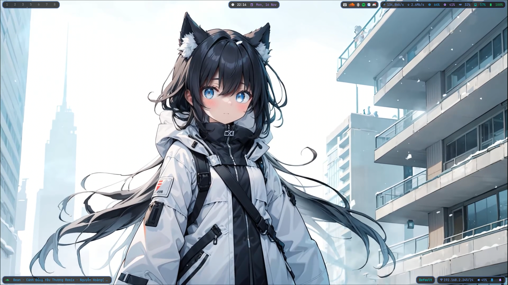

# dotfiles

Personal NixOS configuration built on flake-parts, with a custom profile-based framework.
Main setup: Hyprland, Waybar, Ghostty, fish, and a nixvim-based editor (`coding`).



## Overview

| Component | Choice |
|-----------|--------|
| Distro    | NixOS |
| WM        | Hyprland (main) |
| Bar       | Waybar |
| Terminal  | Ghostty |
| Shell     | fish |
| Editor    | nixvim (profile `coding`) |
| Theming   | Stylix |

Other desktops live in `desktops/`:

- `mango`, `niri`, `river`: work in progress
- `plasma6`, `tty`: available, rarely used

## How it works

`builder/` is a small custom framework that defines the options for hosts,
roles, profiles, and the home-manager / NixOS / nixvim layers.
`outputs.nix` is a flake-parts module that imports the modules and sets those options.

- A **host** (`hosts/`) picks a role and a set of **profiles** (`profiles/`).
- A profile selects which modules to enable from `home/`, `nixos/` and `nixvim/`.
- Modules under `modules/{home,nixos,nixvim}` are the exception:
  they are imported into every profile automatically (base config such as users, hardware, pipewire).

## Structure

```
builder/    # custom framework (options for hosts, profiles, layers)
outputs.nix # flake-parts module wiring modules into the builder
profiles/   # profile definitions (coding, desktop, ci, live, leetcode)
hosts/      # per-host config
home/       # home-manager modules, selected by profiles
nixos/      # NixOS modules, selected by profiles
nixvim/     # nixvim modules, selected by profiles
modules/    # always-imported base modules (home, nixos, nixvim)
desktops/   # desktop environments and window managers
features/   # larger features (e.g. hermes-agent)
pkgs/       # custom packages
overlays/   # nixpkgs overlays
patches/    # patches applied to upstream packages
lib/        # utility functions (lib extension)
data/       # personal data: encrypted files and public keys
assets/     # screenshots
emacs/      # Doom Emacs config (abandoned, unfinished)
```

## Requirements

- NixOS with flakes enabled
- The repo must be cloned to `/workspaces/dotfiles` (many paths are hardcoded)
- All private keys live in `/private`, not in `~`, so containers and system
  services can read them. The sops age key must exist at
  `/private/dotfiles.age-key.txt`, otherwise decryption fails.

## Install

```fish
sudo mkdir -p /workspaces /private
sudo chown $USER /workspaces
git clone https://github.com/Pludex/dotfiles /workspaces/dotfiles
cd /workspaces/dotfiles
# place your age key at /private/dotfiles.age-key.txt
nh os switch
```

## Secrets

`data/` only contains encrypted files and public keys:

| Pattern | Encrypted with |
|---------|----------------|
| `*.enc.yaml`, `*.enc.json` | [sops](https://github.com/getsops/sops) |
| `*.age` | raw [age](https://github.com/FiloSottile/age) (no sops) |
| `*.pub` | public keys, safe to read |

These files are encrypted for my own keys. If you fork this repo, you must
replace them with your own secrets.

## Theming

Colors, fonts and wallpapers are managed by
[Stylix](https://github.com/nix-community/stylix).
`pkgs/schemes` extends [tinted-theming/schemes](https://github.com/tinted-theming/schemes)
with extra color schemes.

## Notes

- This repo is tied to my hardware and personal data. Use it as a reference
  for the structure rather than cloning it as is.
- `emacs/` and `features/android-remote-control-mcp` are unfinished.

## Credits

- [Stylix](https://github.com/nix-community/stylix)
- [tinted-theming/schemes](https://github.com/tinted-theming/schemes)

## License

[MIT](LICENSE)
